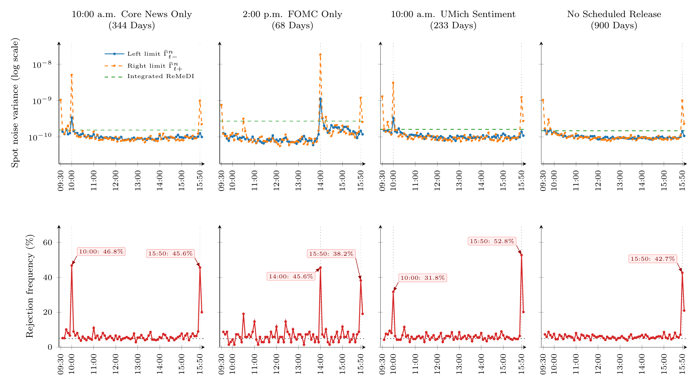
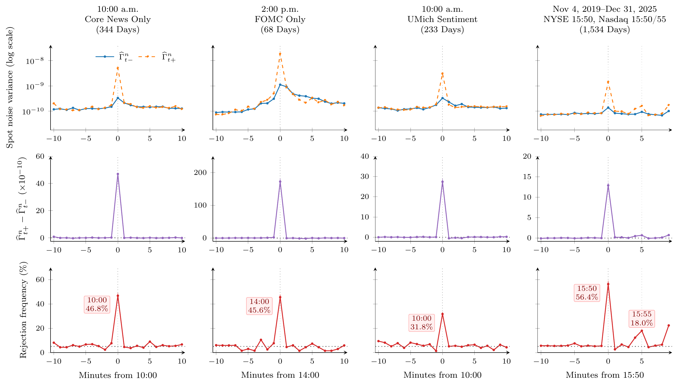

- [Estimation and Inference for Spot Variance of Microstructure Noise](/assets/papers/spotnoise.pdf),
with Haotian Zhang.
   • [DOI](https://doi.org/10.13140/RG.2.2.18903.02724) • [Supplement](/assets/papers/Supple_spotnoise.pdf)  

  **Abstract**: We develop estimation and inference for the spot variance of market microstructure noise, the discrepancy between observed transaction prices and underlying efficient prices arising from trading frictions. The noise is a stationary, serially dependent sequence scaled by the square root of a positive semimartingale that may jump at prescheduled times. Using transaction prices alone, we construct one-sided estimators of the left and right limits of the noise variance from a multi-horizon differencing scheme; averaging over a growing set of horizons renders them asymptotically equivalent to the oracle that observes the noise. We establish a joint stable central limit theorem and provide consistent asymptotic-variance estimators and a test for scheduled jumps. In SPY transactions over 2016--2025, the noise variance jumps at macroeconomic releases and closing-auction deadlines with event-specific recovery dynamics.

  **Empirical Highlights:**

  

    
  

  

    Figure: Intraday spot noise variance (top) and two-sided 5% rejection frequencies (bottom) on a five-minute grid across four announcement day groups (Core News at 10:00, FOMC at 14:00, Michigan Sentiment at 10:00, and Comparison days), SPY 2016–2025. The top row shows cross-day means of $\widehat{\Gamma}_{t-}^n$ and $\widehat{\Gamma}_{t+}^n$ on a logarithmic scale and the group-average full-session single-horizon benchmark. Dotted lines mark the release time, 15:50, and the 5% level.
  

  

    
  

  

    Figure: One-minute event-time profiles of spot noise variance, SPY 2016–2025. The rows show means of paired spot estimates on a logarithmic scale, the mean right-minus-left difference in units of $10^{-10}$, and two-sided 5% rejection frequencies. The first three columns correspond to the announcement groups (Core News, FOMC, and Michigan Sentiment); the last column covers the closing auction from November 4, 2019 onwards. Dotted lines mark the event time, 15:55, and the 5% level.
  

